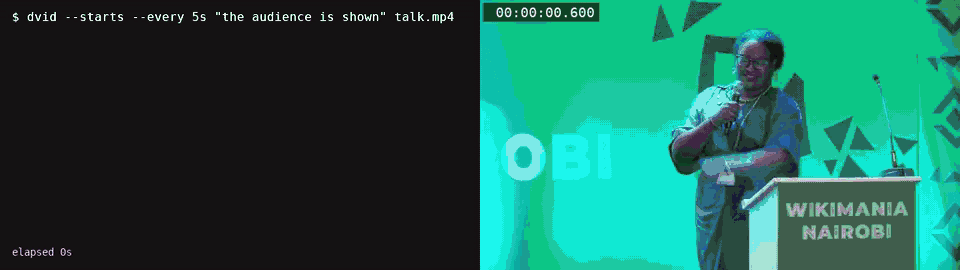

# dvid: grep, for video

dvid tells you when something is true in a video, or cuts the video into labelled sections. It asks a model about one frame every few seconds and prints the times. It works on a video file, or live on a stream: a webcam, a pipe or a stream URL.



`dvid --starts --every 5s "the audience is shown" talk.mp4` prints each time the talk cuts to the audience, as soon as it finds it.

## Install

Install [deem](https://github.com/phyro/deem) (needs Rust 1.89 or newer) and add a model:

```bash
cargo install --locked --git https://github.com/phyro/deem
deem api add jev https://api.typesafe.ai/v1 --pictures --key
```

The second command asks for your API key (or set `JEV_API_KEY`). To use a model on your own machine instead, see [A model of your own](https://github.com/phyro/deem#a-model-of-your-own) in deem's README; dvid sends pictures, so pick one that reads them, such as [d3-mini](https://github.com/phyro/deem#d3-mini-with-picture-support).

Install [ffmpeg](https://ffmpeg.org), which comes with `ffprobe`. On Debian or Ubuntu:

```bash
sudo apt install ffmpeg
```

On macOS:

```bash
brew install ffmpeg
```

Install dvid. It also needs bash and awk, which any Linux or macOS has:

```bash
git clone https://github.com/phyro/dvid
cd dvid
export PATH="$PWD/bin:$PATH"
```

dvid is one script, `bin/dvid`. It finds `programs/` next to its own `bin/` folder, so keep the two together. Put the `export` line in your shell's startup file to keep it.

## Examples

They run from `examples/`, which has two sample videos: `fire.mp4`, two Christmas trees on fire (2:17), and `talk.mp4`, a lightning talk with slides (3:10). From the root of the repository, `cd examples` first.

When is the dry tree on fire?

```sh
# 00:00:00 to 00:00:10 (the title card shows flames too),
# then 00:00:20 to 00:02:10
dvid --every 10s "the dry tree is on fire" fire.mp4
```

It prints `start<TAB>end<TAB>score`, a line for each stretch where the answer is yes:

```
00:00:00	00:00:10	0.93
00:00:20	00:02:10	0.97
```

What is the talk about, section by section?

```sh
# start<TAB>end<TAB>label: about four sections
dvid --every 5s --labels \
  "a title slide,a slide of text,a screenshot of a web page,the audience" \
  talk.mp4
```

Which parts of a YouTube video show an elephant? `yt-dlp -g` prints the video's URL, and `bv*[height<=720]` picks the video alone, small enough, as dvid needs no sound.

```bash
dvid --all --every 3s "an elephant is visible" "$(yt-dlp -g \
  -f 'bv*[height<=720]' 'https://www.youtube.com/watch?v=jNQXAC9IVRw')"
```

What is happening on a Twitch stream, live? A line comes as each section starts. Put a live channel's name in place of `CHANNEL`.

```bash
dvid --starts --every 10s \
  --labels "the road is clear,traffic is stopped" \
  "$(yt-dlp -g https://www.twitch.tv/CHANNEL)"
```

When does someone sit down at a webcam? Stop at the first time.

```bash
dvid --starts --every 5s "someone is sitting at the desk" \
  /dev/video0 | head -1
```

Nothing found is exit 1, as with grep.

## How it works

```
 video file ─┐
 stream URL ─┼──► ffmpeg ─────────► deem ───────────► runs.awk ────────► stdout
 webcam     ─┘    cuts a frame      cam.deem asks     joins frames       the answers,
                  every --every     the model about   with the same      with their
                                    each frame        answer into        times
                                      ▲ │             time spans
                                      │ ▼
                                    the model
                              (hosted API or local)
```

dvid is three stages. ffmpeg cuts frames named by their time in ms. deem answers each frame with `programs/cam.deem`. `programs/runs.awk` turns the answers into the lines you see. `--show` prints the pipeline.

A question per frame costs one picture, 640 px wide. An hour at 30s is 120 questions.

## The model

dvid asks deem, which uses a hosted model or one on your own machine (`--api NAME` picks which). A model of your own keeps the frames on your machine. For streams, see [Live video](#live-video).

## Finding when something happens

Say what you look for as a statement: "the dog is on the couch", not "dog". dvid asks "Is this true in this frame: WHAT?" and prints each run of frames that say yes, with the run's best score.

```sh
# the first 30 s, 5 s at a time
dvid --every 5s --from 0:00 --to 0:30 "the dry tree is on fire" fire.mp4
```

The edges are only as exact as `--every`. To find one closer, look again between those frames, finer: find the minute with `--every 60s`, then run `--every 5s --from 40:00 --to 42:00` on it.

## Splitting a video into labelled sections

`--labels` takes a comma-separated list and picks the label that fits each frame best. Each run of one label is a section. A section shorter than two frames joins the one before it, so one frame of slides in a demo does not split the demo.

```sh
# when each label begins in fire.mp4
dvid --all --every 10s --labels "a title card,a tree catching fire,\
a tree burning all over,a burnt-out tree" fire.mp4 | uniq -f1
```

## Every frame, with --all

`--all` prints every frame: `time<TAB>score`, how sure the model is, or `time<TAB>label` with `--labels`. Use it to see why a run starts or ends, or to plot the scores.

```sh
# a frame each 10 s: high while flames show, very low before either tree burns
dvid --all --every 10s "flames or smoke are visible" fire.mp4
```

## Alarms: --starts and head -1

`--starts` prints a line as soon as a run starts, and `| head -1` keeps the first one. dvid runs no commands itself: whatever reads the lines acts.

```sh
# start<TAB>score: 00:00:00, then 00:00:20
dvid --starts --every 10s "the dry tree is on fire" fire.mp4

# start<TAB>label as each section starts
dvid --starts --every 5s \
  --labels "a slide,a screenshot of a web page" talk.mp4
```

With labels, a section starts once it has lasted two frames, so someone out of view for one frame does not set off an alarm. To act on each line, read them in a loop:

```bash
dvid --starts --every 5s \
  --labels "an empty desk,someone at the desk" /dev/video0 |
while IFS=$'\t' read -r when label; do
  [ "$label" = "an empty desk" ] && echo "desk empty at $when"
done
```

## Things that take time: --frames 4

One frame cannot show a change ("the slide was replaced", "someone waved"). With `--frames 4`, each question sees 4 frames across the `--every`, `--every`/3 apart, as one 2x2 picture, and asks whether WHAT happens in them.

```sh
# a change one frame can't show: most of the talk's slide changes,
# and a cut to the audience. Scores for a change run low, hence -t 0.35
dvid --every 5s --frames 4 -t 0.35 \
  "the slide on the right is replaced by a different slide" talk.mp4
```

Its limits:

- Each frame is a quarter of the picture, so small things are harder to see.
- It tells that something happened better than which way: someone leaving can pass for someone arriving.
- Something shorter than `--every` can still fall between two frames. Pick an `--every` about twice as long as the event.
- The model may read "catches fire" as "is on fire".

## A part of a file: --from and --to

`--from` and `--to` take seconds or `[HH:]MM:SS`. They work on files only, and on a URL that has a length.

```sh
# the slides between 1:00 and 2:00
dvid --every 5s --from 1:00 --to 2:00 \
  --labels "a slide of text,a screenshot of a web page" talk.mp4
```

## Live video

A webcam, a pipe, or a stream URL with no length is live. dvid asks about each frame as it comes, prints each line as soon as it is known, and runs until the video ends or you stop it (`timeout 10m dvid ...`). A time is the clock's. `--from` and `--to` are refused.

A webcam is `/dev/video0` on Linux (see the example above).

A pipe is read at its own pace. `ffmpeg -re` plays a file as a camera would, which lets you try live mode without one:

```sh
# at the first frame (the title card shows flames);
# ffmpeg may say "Broken pipe" when it ends
dvid --starts --every 2s "the dry tree is on fire" \
  <(ffmpeg -loglevel error -re -t 30 -i fire.mp4 -c copy -f mpegts -) |
  head -1

# a line as each frame is answered, for 30 s
dvid --all --every 5s "flames or smoke are visible" \
  <(ffmpeg -loglevel error -re -t 30 -i fire.mp4 -c copy -f mpegts -)
```

`head -1` prints the line at once, but the command ends only when the video does: dvid finds out that `head` has gone only when it next writes.

On a live video, dvid prints:

| | On a live video |
|---|---|
| WHAT | a run once it ends |
| `--labels` | a section once the next has lasted two frames |
| `--all` | every frame, as it is answered |
| `--starts` | a run or section as soon as it starts |

If dvid falls behind (an answer more than 5s, or two frames, after its frame) it says so on stderr. To keep up, raise `--every`, or deem's `--parallel` if your server takes more requests at once.

A URL ffmpeg reads is a video too: an `.mp4` on the web, an HLS playlist, a camera's `rtsp://`. For a page on YouTube, Twitch and many other sites, use `yt-dlp -g` as in the examples.

```bash
dvid --from 5:00 --to 6:00 --every 10s "a rabbit is visible" \
  "https://archive.org/download/BigBuckBunny_124/Content/\
big_buck_bunny_720p_surround.mp4"
```

## Your own question: -q

WHAT is put into a fixed question, "Is this true in it: WHAT?". `-q QUESTION` asks yours instead. With `--frames 4`, the question is about the grid, read left to right, top to bottom.

```sh
# the question is yours; the answer is still yes or no
dvid -q "does the picture show a tree that is burning down?" \
  --every 10s fire.mp4
```

## What it would run: --show

`--show` prints the pipeline instead of running it.

```sh
# the ffmpeg, deem and awk pipeline
dvid --show --every 10s "the dry tree is on fire" fire.mp4
```

## Flags for deem

Any flag dvid does not know goes to deem, after WHAT. For instance `--api NAME` picks a model that you added to deem, and `--parallel N` sets how many questions go at once.

```sh
# deem's own flags go after WHAT
dvid --every 30s "the dry tree is on fire" --parallel 2 fire.mp4
```

## Exit codes

| Code | Meaning |
|---|---|
| 0 | found something (or `--all` and `--starts`, printed lines) |
| 1 | nothing found, as with grep |
| 2 | an error: a bad flag, a missing video, ffmpeg or deem failing |

## Flags

```
dvid [--show] [--all | --starts] [--every N] [--frames 1|4]
     [--from T] [--to T] [-t N] [-q QUESTION]
     (WHAT | --labels A,B,C) [FLAG...] VIDEO
```

| Flag | Default | Meaning |
|---|---|---|
| `--every N` | 30s | the time between frames, one question each; `ms`, `s`, `m`, `h`, fractions too |
| `--frames 1\|4` | 1 | 4: each question sees 4 frames across its `--every`, as a 2x2 grid |
| `-t N` | 0.5 | the score a frame must pass to be in a run (WHAT only, not with `--all`) |
| `--labels A,B,C` | | the label that fits each frame best, instead of WHAT |
| `--all` | | every frame, not just the runs |
| `--starts` | | each run as soon as it starts (not with `--all`) |
| `--from T`, `--to T` | | files only: seconds or `[HH:]MM:SS` |
| `-q QUESTION` | | ask your own question |
| `--show` | | print the pipeline instead of running it |
| any other flag | | goes to deem |

## Privacy

Frames are deleted once answered, but they are sent to the API deem uses. For a room with people in it, use a model of your own (`--api`), which keeps them on your machine.

## Tests

From the root of the repository:

```bash
tests/offline.sh     # every command against a fake deem, no API
tests/programs.sh    # cam.deem and runs.awk on their own
tests/examples.sh    # every example in this README, against a fake deem
```

None of them needs the API. When ffmpeg or deem is missing, the parts that need it print a `skipped:` line and the rest run. `tests/examples.sh --list` prints the commands it finds in this README.

To run the README's examples against your deem and its API, printing what each one found:

```bash
tests/examples.sh --live
```

## License

MIT. See `LICENSE`. `fire.mp4` is cut down from NIST's [Christmas Tree Fire: Watered Tree vs. Dry Tree](https://commons.wikimedia.org/wiki/File:Christmas_Tree_Fire_Watered_Tree_vs._Dry_Tree.webm), a work of the US government in the public domain. `talk.mp4` is cut down from Sam Walton's [How Automoderator can revert vandalism on your wiki - Day 2 - Lightning Talk](https://commons.wikimedia.org/wiki/File:How_Automoderator_can_revert_vandalism_on_your_wiki_-_Day_2_-_Lightning_Talk.webm) (Wikimania 2025), under [CC BY-SA 4.0](https://creativecommons.org/licenses/by-sa/4.0/).
